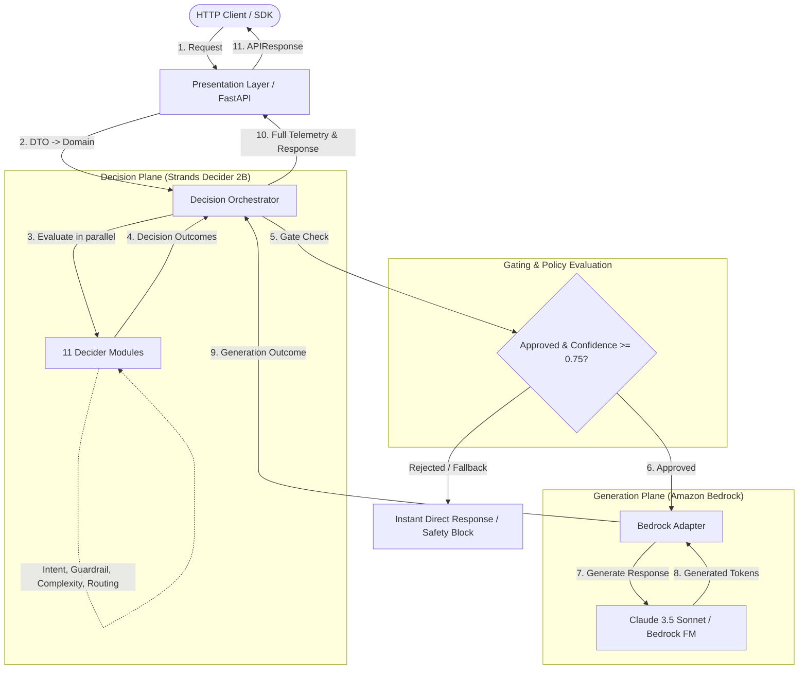

# Cortex AI Decision Engine

[](https://github.com/your-org/cortex-ai-decision-engine/actions/workflows/ci.yml)
[](https://www.python.org/downloads/release/python-3120/)
[](https://fastapi.tiangolo.com)
[](https://docs.astral.sh/uv/)
[](https://github.com/psf/black)
[](https://github.com/astral-sh/ruff)

A high-performance, asynchronous AI Decision Engine built on Clean Architecture principles. It uses **Strands Decider 2B** to make intelligent routing, policy, and classification decisions *before* delegating response generation to **Amazon Bedrock**.

---

## 🏛️ Fundamental Architectural Invariant

| Plane | Component | Strict Responsibility | Prohibited Actions |
|---|---|---|---|
| **Decision Plane** | **Strands Decider 2B** | Evaluates inputs, classifies intent, verifies guardrails, and produces routing decisions. | **NEVER** generates user-facing responses. |
| **Generation Plane** | **Amazon Bedrock** | Generates rich textual or multimodal completions based on decider context. | **NEVER** performs routing or policy evaluation. |

This invariant decouples lightweight, deterministic, low-latency decision trees from expensive foundation model generation, cutting API costs, reducing latency, and enhancing security.

---

## 📁 Project Directory Structure & Rationale

```text
cortex-ai-decision-engine/
├── .github/
│   └── workflows/
│       └── ci.yml                # CI: Ruff linting, Black formatting, Pytest on Python 3.12
├── src/
│   └── cortex/
│       ├── core/                 # Cross-cutting concerns & foundational utilities
│       │   ├── config.py         # Type-safe settings via Pydantic Settings v2
│       │   ├── exceptions.py     # Domain exception hierarchy (Decider/Bedrock/Orchestrator)
│       │   └── logging.py        # Structured JSON logging & correlation ID tracing
│       │
│       ├── domain/               # Pure Enterprise Business Rules (Zero external dependencies)
│       │   ├── models/           # Domain entities (DecisionOutcome, GenerationInput, etc.)
│       │   │   ├── decision.py   # Decision plane data structures
│       │   │   └── generation.py # Generation plane data structures
│       │   └── protocols/        # PEP 544 abstract protocols (Decider, Bedrock, Orchestrator)
│       │       ├── bedrock.py
│       │       ├── decider.py
│       │       └── orchestrator.py
│       │
│       ├── application/          # Use Cases & Application Orchestration
│       │   ├── orchestrators/    # Central Decision Orchestrator (coordinates the 11 modules)
│       │   ├── agents/           # Specialized multi-agent workflows
│       │   └── services/         # Application pipeline services & telemetry helpers
│       │
│       ├── infrastructure/       # Concrete external adapters & drivers
│       │   ├── deciders/         # Implementations of the 11 Strands Decider 2B modules
│       │   ├── bedrock/          # AWS Bedrock asynchronous boto3/aioboto3 adapters
│       │   └── benchmarking/     # Latency, accuracy, and cost tracking harness
│       │
│       ├── presentation/         # Driving adapters (REST API / Transport layer)
│       │   ├── api/
│       │   │   ├── deps.py       # FastAPI dependency injection providers
│       │   │   └── v1/
│       │   │       ├── router.py # Master API v1 router
│       │   │       └── endpoints/
│       │   │           ├── health.py # Health, liveness, and readiness probes
│       │   │           └── demo.py   # Demo endpoint scaffold for hackathon testing
│       │   ├── middleware/       # Correlation ID & request latency timing middleware
│       │   └── schemas/          # API Request/Response DTOs and unified API envelope
│       │
│       └── main.py               # FastAPI application factory, lifespan, and exception handlers
│
├── tests/
│   ├── conftest.py               # Shared pytest fixtures & async HTTPX client
│   ├── unit/                     # Fast isolated unit tests (config, domain entities)
│   └── integration/              # End-to-end API & middleware integration tests
│
├── .dockerignore
├── .env.example                  # Environment variable reference template
├── .gitignore
├── docker-compose.yml            # Local development orchestration with live reloading
├── Dockerfile                    # Multi-stage production container image with uv
├── pyproject.toml                # Project metadata, dependencies, Ruff/Black/Pytest config
└── README.md
```

### Why Each Folder Exists (Clean Architecture & SOLID)

1. **`src/cortex/domain/`**:
   - **Purpose**: Represents the core business concepts of our decision engine.
   - **SOLID**: Follows the **Single Responsibility Principle (SRP)** and **Dependency Inversion Principle (DIP)**. It contains zero references to FastAPI, AWS SDKs, or databases. Any external framework change will never affect the domain.
   - **Protocols (`protocols/`)**: Defines abstract PEP 544 structural subtyping contracts (`DeciderProtocol`, `BedrockClientProtocol`). High-level modules depend on these abstractions, not on concrete AWS SDKs or model weights.

2. **`src/cortex/core/`**:
   - **Purpose**: Provides cross-cutting platform concerns including type-safe configuration (`Pydantic Settings v2`), correlation-aware structured logging, and an expressive domain exception tree.

3. **`src/cortex/application/`**:
   - **Purpose**: Implements the use cases.
   - **`orchestrators/`**: Reserved for the upcoming **Decision Orchestrator**, which executes the 11 decision modules in parallel or sequence, evaluates confidence thresholds, and decides if Bedrock should be invoked.
   - **`agents/`**: Reserved for multi-agent workflows that consult the Decider before taking actions.
   - **`services/`**: Coordinates persistence, caching, and pipeline dispatch.

4. **`src/cortex/infrastructure/`**:
   - **Purpose**: Implements the technical details.
   - **`deciders/`**: Where the **11 Strands Decider 2B** modules will live.
   - **`bedrock/`**: Where the AWS Bedrock client adapter resides (managing boto3 sessions, retries, exponential backoff, and credentials).
   - **`benchmarking/`**: Measures latency profiles, comparing raw LLM calls vs. Decider-gated calls.

5. **`src/cortex/presentation/`**:
   - **Purpose**: The driving adapter layer (FastAPI HTTP endpoints, DTO schemas, and HTTP middleware). It adapts incoming HTTP requests to domain models and formats domain results into standard JSON envelopes.

---

## ⚡ Tech Stack

- **Python 3.12**: Leveraging modern features (e.g. `type` statements, enhanced asyncio performance, strict typing).
- **Astral `uv`**: Ultra-fast Rust-based Python package manager and resolver.
- **FastAPI**: Asynchronous web framework with automatic OpenAPI docs.
- **Pydantic v2**: High-speed Rust-based data validation and settings management.
- **AWS Bedrock / Boto3 / aioBoto3**: Fully async AWS foundation model invocations.
- **Ruff & Black**: Modern linting, formatting, and code standards enforcement.
- **Pytest & Pytest-Asyncio**: Asynchronous test runner with coverage reporting.
- **Docker**: Multi-stage, non-root, cache-optimized containerization.

---

## 🚀 Quick Start (Local Development)

### 1. Prerequisites

Ensure you have **Python 3.12+** and **uv** installed:

```bash
# On Windows (PowerShell):
powershell -c "irm https://astral.sh/uv/install.ps1 | iex"

# On macOS/Linux:
curl -LsSf https://astral.sh/uv/install.sh | sh
```

### 2. Environment Setup

Clone the repository and copy the environment template:

```bash
cp .env.example .env
```

### 3. Install Dependencies

Using `uv`, sync the environment and install dev extras:

```bash
uv sync --all-extras --dev
```

### 4. Run the Development Server

```bash
uv run uvicorn cortex.main:app --host 0.0.0.0 --port 8000 --reload
```

The server is available at:
- **Interactive OpenAPI Documentation**: [http://localhost:8000/docs](http://localhost:8000/docs)
- **Alternative ReDoc Documentation**: [http://localhost:8000/redoc](http://localhost:8000/redoc)
- **Health Check**: [http://localhost:8000/api/v1/health](http://localhost:8000/api/v1/health)
- **Demo Pipeline Scaffold**: `POST http://localhost:8000/api/v1/demo/decide-and-generate`

---

## 🐳 Docker & Docker Compose

### Run via Docker Compose

```bash
docker compose up --build
```

### Standalone Docker Build

```bash
docker build -t cortex-ai-decision-engine:latest .
docker run -p 8000:8000 --env-file .env cortex-ai-decision-engine:latest
```

---

## 🧪 Testing, Quality & CI/CD

### Run Pytest Suite

```bash
# Run tests with coverage
uv run pytest --cov=src/cortex --cov-report=term-missing
```

### Run Linter & Formatter

```bash
# Check code style with Ruff
uv run ruff check .

# Check code formatting with Black
uv run black --check .

# Automatically apply Ruff fixes & Black formatting
uv run ruff check --fix .
uv run black .
```

---

## 🧠 First AI Decision Module: IntentDecider (Strands Decider 2B)

`IntentDecider` is the first production-ready AI decision module in the Cortex AI Decision Engine. It uses **Strands Decider 2B** to determine the single best intent category without any hardcoded rule matching or frontier model generation.

### Why Strands Decider 2B is Used
- **Sub-50ms Latency**: Frontier models (Claude 3.5 Sonnet, GPT-4) take 800ms-2s just to classify intent. Strands Decider 2B evaluates semantic intent in tens of milliseconds.
- **Cost Efficiency**: Frontier model token pricing is avoided for routing decisions.
- **Strict Invariant**: Strands Decider 2B **ONLY** makes decisions; it never generates output responses.

### Strictly Allowed Intent Categories
Strands Decider 2B evaluates the query and returns **exactly ONE** category:
1. `CHAT`: Casual conversation, chit-chat, greetings.
2. `WRITING`: Composition, prose, essays, drafts, or editing.
3. `CODING`: Programming, software engineering, debugging, scripts, or cloud architecture.
4. `RESEARCH`: Deep factual discovery, external information synthesis, literature inquiries.
5. `ANALYSIS`: Comparative critiques, numerical/risk evaluations, financial or logical assessments.
6. `PLANNING`: Sequential roadmaps, action plans, itineraries, sprint backlogs.
7. `VISION`: Multimodal image comprehension, OCR, diagram reading.

### Developer Reusability Pattern
To implement any of the remaining 10 decision modules (e.g. `PrivacyDecider`, `RiskDecider`, `ComplexityDecider`):
1. Inherit from [`BaseDecisionModule`](src/cortex/infrastructure/deciders/base.py).
2. Set unique `module_id`, `name`, `decision_type`, and execution `order` (1–11).
3. Inject [`StrandsDeciderClientProtocol`](src/cortex/domain/protocols/strands_client.py) via `__init__`.
4. Implement `_compute_decision(state: CortexState)`:
   - Call `await self.client.decide(...)` with task name and permitted categorical options.
   - Validate model output strictly (confidence, allowed values).
   - On error or invalid output, raise domain exception (`DeciderInferenceError`, `DeciderTimeoutError`).
5. Implement `apply_to_state(state: CortexState, outcome: DecisionOutcome)` to mutate the corresponding field on `CortexState`.
6. Add the module to [`get_default_decision_modules()`](src/cortex/infrastructure/deciders/registry.py).

---

## 🤖 Second AI Decision Module: AgentSelectionDecider (Strands Decider 2B)

`AgentSelectionDecider` is the second production AI decision module in the pipeline. It answers a fundamentally different architectural question from Intent Classification:

| Decision Step | Core Question Answered | Example Decisions |
|---|---|---|
| **Step 1: IntentDecider** | *"What is the user trying to do at a high level?"* | `CODING`, `RESEARCH`, `WRITING`, `ANALYSIS` |
| **Step 2: AgentSelectionDecider** | *"Which specialized internal agent is best suited to solve this specific request?"* | `DevOpsAgent`, `DebuggingAgent`, `RefactoringAgent` |

### Why Agent Selection is a Separate AI Decision from Intent Classification
A simplistic 1-to-1 mapping between Intent and Agent renders a multi-agent system redundant. Under the **SAME** intent (e.g. `CODING`), different technical tasks require completely different tools, domain context, and agent personas:
- **`Intent = CODING`**:
  - *"Why is my async task hanging with deadlock?"* $\rightarrow$ **`DebuggingAgent`** (root cause analysis, stack traces)
  - *"Deploy this FastAPI container to AWS ECS Fargate with Terraform."* $\rightarrow$ **`DevOpsAgent`** (cloud architecture, Docker, CI/CD)
  - *"Refactor this 600-line class to follow Single Responsibility."* $\rightarrow$ **`RefactoringAgent`** (code restructuring, modularity)
  - *"Audit this AES-GCM encryption code for security vulnerabilities."* $\rightarrow$ **`CodeReviewAgent`** (security auditing, quality gates)
  - *"Implement an AVL balanced binary tree in Python."* $\rightarrow$ **`SoftwareEngineerAgent`** (algorithm implementation)
- **`Intent = RESEARCH`**:
  - Academic papers and citations $\rightarrow$ **`LiteratureReviewAgent`**
  - Real-time internet facts & market data $\rightarrow$ **`WebResearchAgent`**
  - Claim validation & source checking $\rightarrow$ **`FactCheckingAgent`**
  - Hardware & RFC protocol whitepapers $\rightarrow$ **`TechnicalResearchAgent`**
- **`Intent = WRITING`**:
  - Executive & client correspondence $\rightarrow$ **`EmailWriterAgent`**
  - API documentation & developer guides $\rightarrow$ **`TechnicalWriterAgent`**
  - Landing page copy & announcements $\rightarrow$ **`MarketingCopyAgent`**
- **`Intent = ANALYSIS`**:
  - Threat modeling & migration risk $\rightarrow$ **`RiskAnalysisAgent`**
  - Unit economics, cloud ROI & valuation $\rightarrow$ **`FinancialAnalysisAgent`**
  - Statistical datasets & numerical trends $\rightarrow$ **`DataAnalysisAgent`**
- **`Intent = VISION`**:
  - Scanned text, receipts, and table extraction $\rightarrow$ **`OCRAgent`**
  - System architecture schemas & UML flowcharts $\rightarrow$ **`DiagramAnalysisAgent`**

### Dynamic Extensibility via `AgentRegistry`
To add a new specialized agent without modifying the orchestrator or `AgentSelectionDecider`:
```python
from cortex.application.agents.registry import get_default_agent_registry
from cortex.domain.models.agent import AgentProfile
from cortex.domain.models.intent import IntentCategory

registry = get_default_agent_registry()
registry.register(
    AgentProfile(
        name="QuantumCryptographyAgent",
        intents=[IntentCategory.CODING, IntentCategory.RESEARCH],
        description="Specialized in post-quantum lattice cryptography and Shor's algorithm.",
        capabilities=["post_quantum_crypto", "qiskit", "lattice_algorithms"],
    )
)
```
Strands Decider 2B dynamically considers the newly registered agent profile when evaluating requests matching those intents!

---

## 🔒 Third AI Decision Module: PrivacyDecider (Strands Decider 2B)

`PrivacyDecider` is the third production AI decision module in the pipeline. It evaluates the contextual prompt (incorporating `user_input`, `intent`, `selected_agent`, and `metadata`) to determine the exact data privacy classification required for the request.

It answers **ONLY ONE** question:
> *"What level of privacy, confidentiality, and data handling does this request require?"*

### Why Privacy is a Separate Decision from Risk
Conflating **Privacy** with **Risk** is a major architectural anti-pattern in AI systems:
- **Privacy** classifies *data sensitivity and confidentiality requirements*.
- **Risk** (Module 4) classifies *harmful intent, jailbreaks, prompt injection, and safety policy violations*.

| Scenario | Privacy Classification | Risk Classification | Architectural Action |
|---|---|---|---|
| User uploads an MRI scan: *"Explain my cerebellar MRI report"* | **`MEDICAL`** (Protected Health Information) | **`LOW`** (Benign, safe healthcare query) | **Process request**, but enforce HIPAA redaction in logs and use zero-retention model endpoints. |
| User asks: *"Write a script to port-scan 192.168.1.0/24 and flood SYN packets"* | **`PUBLIC`** (Public networking protocols) | **`CRITICAL`** (Malicious exploit / DDoS generation) | **BLOCK immediately** at RiskDecider gate. |
| User inputs corporate M&A deck: *"Summarize acquisition liabilities"* | **`CONFIDENTIAL`** (Proprietary corporate secrets) | **`LOW`** (Standard benign business analysis) | **Process request**, but disable semantic caching and purge external RAG storage. |

### The 6 Allowed Privacy Classifications
1. `PUBLIC`: Open-source knowledge, standard documentation, general queries. No sensitive information.
2. `PERSONAL`: Personally Identifiable Information (PII) of private individuals (home addresses, SSNs, phone numbers, family details).
3. `FINANCIAL`: Banking credentials, tax forms, payroll records, credit card numbers, corporate balance sheets, wire transfers.
4. `MEDICAL`: Protected Health Information (PHI), diagnostic lab reports, clinical charts, prescription histories, patient symptoms.
5. `LEGAL`: Non-disclosure agreements (NDAs), attorney-client communications, litigation briefs, contracts, court filings.
6. `CONFIDENTIAL`: Proprietary internal source code, corporate credentials, unreleased strategic M&A plans, trade secrets.

### Downstream Architectural Impact of `PrivacyLevel`
The `PrivacyLevel` output stored on `CortexState` actively drives downstream decisions:
1. **Context Decider (Module 6)**: Disables external third-party search or shared vector database retrieval when privacy is `MEDICAL`, `FINANCIAL`, or `CONFIDENTIAL`.
2. **Model Selection Decider (Module 9)**: Routes `CONFIDENTIAL`, `MEDICAL`, and `LEGAL` requests strictly to private AWS Bedrock VPC endpoints under dedicated compliance boundaries (HIPAA, SOC2, PCI-DSS).
3. **Cost Strategy & Semantic Caching (Module 10)**: Prevents caching prompts and responses tagged with sensitive privacy levels to prevent accidental data leaks across tenants.
4. **Logging & Observability**: Triggers redaction of raw prompt tokens in central structured logs.

---

## 🛡️ Fourth AI Decision Module: RiskDecider (Strands Decider 2B)

`RiskDecider` is the fourth production AI decision module in the pipeline. It runs immediately after `PrivacyDecider`.

It answers **EXACTLY ONE** question:
> *"How risky is this request to system stability, operational integrity, and safety if the system proceeds?"*

### Why Risk is a Separate Decision from Privacy
- **PrivacyDecider** classifies *data sensitivity and confidentiality requirements*.
- **RiskDecider** classifies *operational risk, destructive side effects, prompt injections, and safety violations*.

A request can be **MEDICAL / FINANCIAL** (High Privacy) but **LOW** Risk (e.g. asking for clinical definitions of test results), meaning it should proceed under strict confidentiality.
Conversely, a request can be **PUBLIC** (Low Privacy) but **CRITICAL** Risk (e.g. generating a denial-of-service script against a public IP), meaning it must be **BLOCKED immediately**.

### The 4 Allowed Risk Levels & Downstream Pipeline Impact

| Risk Level | Operational Meaning | Downstream Pipeline Impact |
|---|---|---|
| **`LOW`** | Benign informational, creative, educational, or read-only queries with zero operational hazard. | **Continue normally** through standard decision routing and baseline compute. |
| **`MODERATE`** | Reversible operational modifications, infrastructure changes, schema migrations, or batch updates. | **Enable step verification**; triggers parameter validation in ToolSelectionDecider (Module 5). |
| **`HIGH`** | Potentially destructive data mutations (e.g. database drop, bulk file deletion, production config overrides). | **Require stronger model reasoning** in ModelSelectionDecider (Module 9), and **disable automatic tool execution** (dry-run only). |
| **`CRITICAL`** | Malicious prompt injection / jailbreaks, exploit payloads, automated exfiltration, or safety violations. | **Immediate pipeline termination** by DecisionOrchestrator. Halts execution, marks state `BLOCKED`, and skips Amazon Bedrock. |

---

## 🛠️ Fifth AI Decision Module: ToolSelectionDecider (Strands Decider 2B)

`ToolSelectionDecider` is the fifth production AI decision module in the pipeline. It runs immediately after `RiskDecider`.

It answers **EXACTLY ONE** question:
> *"What technical capabilities or external tools are required to fulfill this request?"*

### Why Tool Selection is Different from Agent Selection
- **Agent Selection (Module 2)** chooses **WHO** will solve the request (persona, cognitive framing, domain expert).
- **Tool Selection (Module 5)** chooses **WHAT** capabilities, I/O interfaces, or tools are required to execute it.

An agent is **NOT** a tool:
- A `DevOpsAgent` might need `["DATABASE", "CODE_EXECUTION"]` to inspect a cluster database.
- A `LiteratureReviewAgent` might need `["WEB_SEARCH", "FILE_READER", "RAG"]`.
- A `FinancialAnalysisAgent` might need `["FILE_READER", "CALCULATOR"]`.
- A conversational task might need `["NONE"]`.

### The 9 Allowed Tools (Supports Multi-Tool Selection)
Strands Decider 2B returns a **list of tools** (`list[ToolType]`):
1. `NONE`: Pure language reasoning, conversational synthesis, or static deduction. Zero tools needed.
2. `WEB_SEARCH`: Accessing live internet information, current market prices, or real-time news.
3. `CALCULATOR`: Performing exact arithmetic, formula evaluations, variance computations, or financial math.
4. `FILE_READER`: Parsing uploaded documents, PDFs, CSV spreadsheets, or text files.
5. `VISION`: Interpreting visual diagrams, OCR scans, UI screenshots, or images.
6. `DATABASE`: Querying SQL databases, executing relational queries, or accessing persistent records.
7. `CODE_EXECUTION`: Running Python scripts or running commands in an isolated execution sandbox.
8. `MEMORY`: Recalling cross-session historical context, past discussions, or user preferences.
9. `RAG`: Retrieving semantic embeddings and text chunks from private vector databases.

Examples of returned lists:
- `["WEB_SEARCH"]`
- `["FILE_READER", "WEB_SEARCH"]`
- `["VISION", "FILE_READER"]`
- `["NONE"]`

### Downstream Architectural Impact of `selected_tools`
The list of tools stored on `CortexState.selected_tools` drives later decision modules:
1. **Context Decider (Module 6)**: Ingests documents if `FILE_READER` or `RAG` is active; fetches conversation history if `MEMORY` is active.
2. **Vision Requirement Decider (Module 7)**: Automatically confirms visual pipeline activation if `VISION` is in `selected_tools`.
3. **Complexity Decider (Module 8)**: Multi-tool pipelines elevate the task complexity tier from `SIMPLE` to `MODERATE` or `COMPLEX`.
4. **Model Selection Decider (Module 9)**: Ensures the chosen Bedrock model natively supports Function Calling / Tool Use API (e.g. Claude 3.5 Sonnet Tool Use).
5. **Execution Optimization**: Prevents spinning up sandboxes or allocating external I/O when `["NONE"]` is selected.

---

## 📚 Sixth AI Decision Module: ContextSelectionDecider (Strands Decider 2B)

`ContextSelectionDecider` is the sixth production AI decision module in the pipeline. It runs immediately after `ToolSelectionDecider`.

It answers **EXACTLY ONE** question:
> *"What specific information should be retrieved and injected into the foundation model prompt context?"*

### Why Context Selection is Different from Tool Selection
- **Tool Selection (Module 5)** answers: *"**WHAT** capabilities are required?"* (e.g. `WEB_SEARCH`, `FILE_READER`, `RAG`, `DATABASE`).
- **Context Selection (Module 6)** answers: *"**WHAT INFORMATION** should the model actually receive?"* (e.g. `["WEB_RESULTS", "RAG_KNOWLEDGE_BASE"]` vs `["SYSTEM_PROMPT_ONLY"]`).

A tool represents an execution mechanism; a context source represents an ingested knowledge payload:
- A tool like `WEB_SEARCH` can execute a search query, but `ContextSelectionDecider` determines whether the search snippets (`WEB_RESULTS`) need to be injected into the prompt, or if cached `USER_MEMORY` is sufficient.
- For purely algorithmic or creative prompts (*"Write a Python script to compute Fibonacci recursively"*), no external context is needed, and `ContextSelectionDecider` selects `["SYSTEM_PROMPT_ONLY"]`.

### The 8 Allowed Context Sources (Supports Multi-Source Injection)
Strands Decider 2B returns a **list of context sources** (`list[ContextSourceType]`):
1. `NONE`: No external context. Equivalent to `SYSTEM_PROMPT_ONLY`.
2. `CHAT_HISTORY`: Conversational turns from preceding interactions in the active session.
3. `USER_MEMORY`: User-specific preferences, profile parameters, or cross-session persistent facts.
4. `UPLOADED_FILES`: Local files, documents, PDFs, or CSV spreadsheets provided by the user.
5. `RAG_KNOWLEDGE_BASE`: Indexed vector embeddings and documentation chunks from enterprise knowledge bases.
6. `WEB_RESULTS`: External real-time search snippets or web page text retrieved from internet search.
7. `DATABASE_RESULTS`: Records, schemas, or query results retrieved from transactional or analytical databases.
8. `SYSTEM_PROMPT_ONLY`: Pure standalone prompt evaluation with zero injected external knowledge or history.

Examples of returned lists:
- `["UPLOADED_FILES"]`
- `["CHAT_HISTORY", "USER_MEMORY"]`
- `["WEB_RESULTS", "RAG_KNOWLEDGE_BASE"]`
- `["SYSTEM_PROMPT_ONLY"]`

### How This Module Optimizes Tokens, Cost, and Latency
1. **Token Window Reduction**: Frontier models (Amazon Bedrock Claude 3.5 Sonnet) charge per input token. Injecting 50k tokens of unpruned context costs money and degrades time-to-first-token (TTFT). Pruning context down to strictly necessary sources reduces cost by 40–80%.
2. **Elimination of Unnecessary Retrieval**: Bypasses expensive vector database queries, internet search queries, or disk I/O when `SYSTEM_PROMPT_ONLY` is selected.
3. **Mitigating "Lost-in-the-Middle" Hallucinations**: Overwhelming LLMs with irrelevant background facts degrades attention. Injecting only verified relevant context sources enhances output accuracy.

---

## 👁️ Seventh AI Decision Module: VisionRequirementDecider (Strands Decider 2B)

`VisionRequirementDecider` is the seventh production AI decision module in the pipeline. It runs immediately after `ContextSelectionDecider`.

It answers **EXACTLY ONE** question:
> *"What type of visual processing does this request require?"*

### Critical Architectural Boundary
- This module does **NOT** perform image understanding or analyze images.
- It **ONLY** decides the required visual reasoning capability category.
- It strictly preserves the Strands Decider 2B invariant: **Only make decisions; never generate completions**.

### Why VisionRequirementDecider is Different from Tool Selection
- **Tool Selection (Module 5)** determines *available system capabilities and I/O tools* (e.g. setting `["VISION", "FILE_READER"]` if the agent has image-viewing access).
- **VisionRequirementDecider (Module 7)** determines *whether multimodal reasoning is actually necessary* and identifies the exact cognitive visual modality required.

Even when `VISION` is enabled as an accessible tool:
- If the user provides a text-only query with no visual assets, `VisionRequirementDecider` returns **`NONE`**, preventing unnecessary invocation of multimodal model pathways.
- If visual assets are present, `VisionRequirementDecider` pinpoints the precise processing sub-modality (`OCR`, `IMAGE_UNDERSTANDING`, `DIAGRAM_ANALYSIS`, `UI_ANALYSIS`, or `MULTIMODAL`).

### The 6 Allowed Vision Requirements

| Vision Requirement | Description & Modality | Example Triggers |
|---|---|---|
| **`NONE`** | Zero visual reasoning required. Pure text processing. | Text queries, coding questions, essays, no attached imagery. |
| **`OCR`** | Optical Character Recognition for tabular text, forms, receipts, or invoices. | Scanned receipts, restaurant bills, invoice scans, tabular forms. |
| **`IMAGE_UNDERSTANDING`** | Natural scene, landscape, object, or photographic image inspection. | Scenic photos, artwork, product photos, real-world scenes. |
| **`DIAGRAM_ANALYSIS`** | Technical architecture, network topology, flowcharts, schemas, UML. | AWS cloud architecture diagrams, UML class diagrams, database ERDs. |
| **`UI_ANALYSIS`** | Software interfaces, app screenshots, wireframes, frontend layouts. | Web app screenshots, mobile mockups, UI bug inspection, button alignment. |
| **`MULTIMODAL`** | Rich mixed documents containing interleaved text, charts, and images. | Multi-page PDF reports, research papers with graphs and figures. |

### How This Decision Affects Model Routing & Downstream Execution
The outcome of `VisionRequirementDecider` directly drives **Model Routing (Module 9)** and execution dispatch:

1. **`NONE`**:
   - Enables Model Routing to select fast, cost-effective text-only models (e.g. Anthropic Claude 3 Haiku, Amazon Titan Text, Meta Llama 3 8B).
   - Eliminates image token preprocessing fees, saving up to 80% on compute costs and reducing TTFT (Time to First Token) by ~70%.

2. **`OCR`**:
   - Routes the asset to dedicated high-speed document extraction engines (such as Amazon Textract or specialized OCR microservices).
   - Extracts structured textual tables and JSON before prompt synthesis, avoiding costly multi-megapixel vision tokenization in frontier models.

3. **`DIAGRAM_ANALYSIS` & `UI_ANALYSIS`**:
   - Directs Model Routing to high-resolution multimodal foundation models (such as Amazon Bedrock Claude 3.5 Sonnet).
   - Tunes inference parameters for spatial bounding-box reasoning, component hierarchy resolution, and topological layout parsing.

4. **`MULTIMODAL`**:
   - Directs Model Routing to large-context multimodal engines equipped for multi-page document reasoning with interleaved charts, tables, and narrative paragraphs.

---

## 🗺️ Roadmap: Ready for Upcoming Additions

This foundation is architected to seamlessly accommodate the next implementation phases without structural refactoring:



1. **11 Strands Decider 2B Modules**:
   Implement concrete classes in `src/cortex/infrastructure/deciders/` satisfying `DeciderProtocol` (e.g., `intent_decider.py`, `guardrail_decider.py`, `complexity_decider.py`, `routing_decider.py`, etc.).
2. **Decision Orchestrator**:
   Implement in `src/cortex/application/orchestrators/` to fan-out decision requests across modules using `asyncio.gather()`, apply weightings, and gate calls to Bedrock.
3. **Multiple AI Agents**:
   Add specialized agents in `src/cortex/application/agents/` inheriting from domain agent protocols.
4. **Amazon Bedrock Integration**:
   Implement asynchronous client in `src/cortex/infrastructure/bedrock/` wrapping Bedrock Converse API / InvokeModel.
5. **Benchmarking Harness**:
   Populate `src/cortex/infrastructure/benchmarking/` with latency analyzers and cost comparison calculators.
